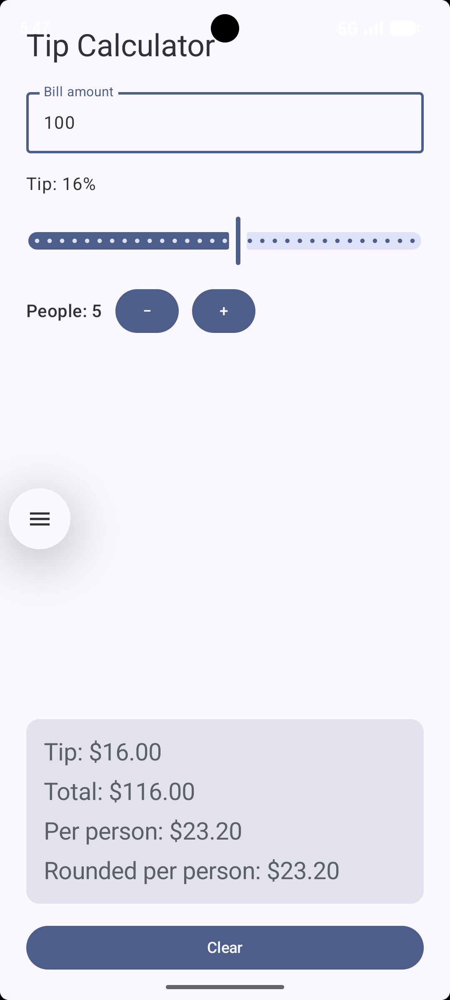

# TipCalc — Lab 1

*Name:* Kentiter Ruby Atoator-Addingi
*Matric Number:* U23cp1003
*N:* 1003

## Personalized Parameters (N = 1003)
- *P (default people):* 5  (Formula: 2 + (1003 mod 8) = 2 + 3 = 5)
- *Δ (rounding step):* $0.20 (Formula: 0.05 × (1 + (1003 mod 4)) = 0.05 × 4 = 0.20)
- *R (initial/reset tip):* 16% (Formula: 5 + (1003 mod 16) = 5 + 11 = 16)

## Where each value appears in the app
- P = 5 → "People" stepper default on launch and after Clear.
- Δ = 0.20 → "Rounded per person" line in the result card rounds UP to the nearest $0.20.
- R = 16% → Tip slider initial value on launch and after Clear.

## Build & Run Instructions
1. Open the project in Android Studio.
2. Allow Gradle to sync.
3. Run the app configuration on an Android Emulator (API 24 or higher).

## Screenshots
